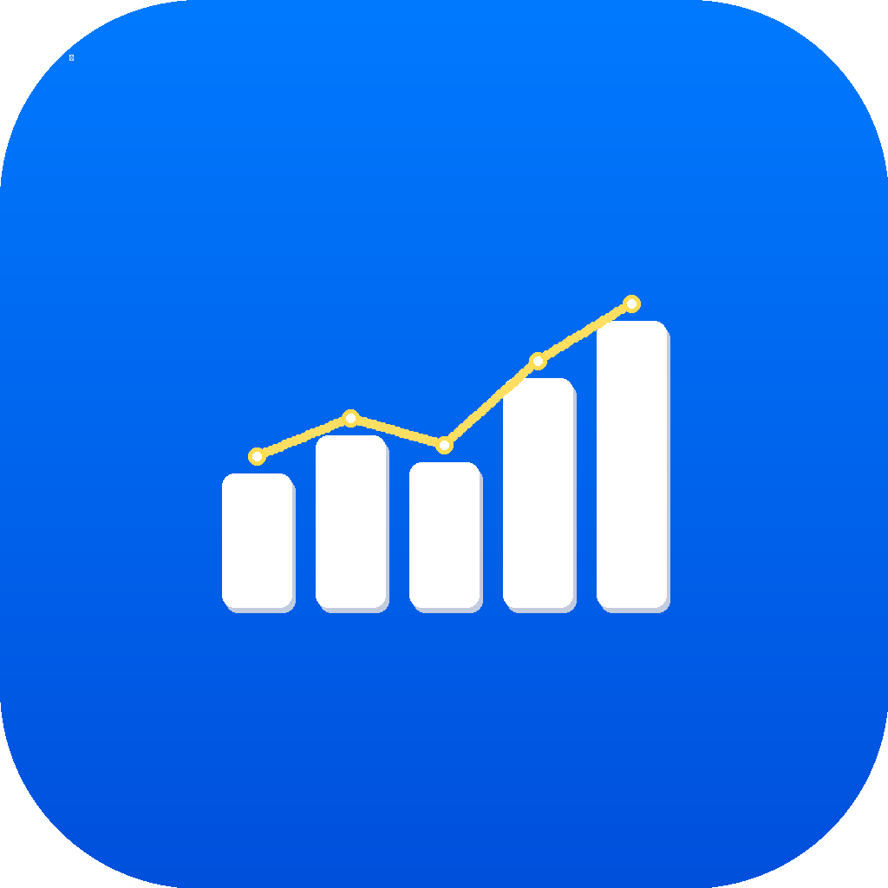

# Balance

A local-first money app for macOS and Windows. Track what you spend, what you
earn, and what you own — all of it stored on your computer.

**Your figures stay on your computer.** There is no account to make and no
server to sign in to. Currency conversion fetches public rates using only dates
and currency codes; your amounts and merchant names stay on your disk.

## Install

### Windows

The Windows release is for x64 PCs. Download
`Balance-Windows-x64-Setup.exe` from the [latest release](../../releases/latest)
and run it. The installer checks for the Microsoft Edge WebView2 Runtime and
the Microsoft Visual C++ Redistributable (x64), and installs missing
prerequisites. Start **Balance** from the Start menu when setup finishes.

Windows may warn that SmartScreen does not recognize the publisher because
these builds are unsigned. Only continue if you downloaded the installer from
the project's GitHub releases. In the warning, choose **More info**, then
**Run anyway**.

The portable option is `Balance-Windows-x64.zip`. Choose **Extract All**, keep
the extracted folder together, and run `Balance.exe` inside it. The portable
build needs WebView2 and the Visual C++ Redistributable (x64) already installed.
Both Windows options keep your database in `%LOCALAPPDATA%\Balance`, outside the
app folder, so replacing or moving the app does not replace your figures.

For transferring an existing database, see the
[Windows guide](docs/guides/windows.md).

### macOS

You need a Mac with Apple silicon (an M1, M2, M3 or M4 chip). To check, open the
Apple menu, then **About This Mac** — the Chip line should say Apple, not Intel.

**1.** Download `Balance-macOS-arm64.zip` from the
[latest release](../../releases/latest) and double-click to unzip.

**2.** Drag `Balance.app` into your Applications folder.

**3.** Open **Terminal** (press Cmd+Space, type Terminal, press Return), paste
this line and press Return:

```
xattr -cr /Applications/Balance.app
```

Nothing will print. That is normal. Now open Balance from your Applications
folder. You only need this once — the app is not signed with a paid Apple
developer certificate, so macOS blocks it until you clear the flag.

## Getting later versions

Quit Balance, then paste this into Terminal:

```
curl -fsSL https://raw.githubusercontent.com/JuliusPaulin/balance-app/main/update.sh | bash
```

It fetches the newest release, installs it and clears the macOS block. Your
figures are untouched — they live outside the app.

## What it does

- **Transactions** — add, edit, delete and filter expenses and income
- **CSV import** — Finnish bank statements, Nordea account and Platinum exports,
  Finnair credit card, and Revolut account statements
- **Currency conversion** — foreign CSV amounts convert to EUR at the transaction
  date's ECB reference rate. Weekends and holidays use the last published rate.
  Review shows the original amount, rate and rate date. Settings → Import currency
  sets the fallback for files with no currency column; each upload can override it.
- **Auto-categories** — merchant rules (exact, contains, fuzzy) sort rows for
  you, with a live preview while you write a rule and one-click re-apply to past
  transactions
- **Dashboard** — month by month spend against income, spending and income
  broken down by category, and annual reports. Click a month to see everything
  in it; the period picker follows you down the page
- **Spending heatmap** — a year calendar you can drill into by day
- **Net worth** — accounts, loans and investment holdings over time
- **Split costs** — halve every imported amount in one click, for shared spending
- **Month notes** — attach context to any month
- **Balance AI** — ask about your money in plain English, answered by a model
  running on your own computer (see below)
- **Auto-backup** — a safe snapshot before every import and on quit

Revolut imports use **Started Date** and include only completed rows. Currency
exchanges are skipped; transfers and refunds remain in review. Fees on imported
rows reduce the signed amount before conversion. These are reference rates,
so the EUR value may differ from Revolut's own exchange price. Balance caches
past rates from [Frankfurter's ECB feed](https://frankfurter.dev/providers/ecb/)
and stops the import if it cannot get a valid rate. Confirmed amounts stay fixed.

## Balance AI

Ask it things — *what did I spend on groceries last month*, *did I spend more in
July than in June*, *analyse my latest month and tell me what stands out* — and
it answers from your own figures.

The built-in model runs on your computer. It is not a service and needs no
account or API key. The model reads your local figures; it does not send your
spending to a model provider. It works offline after its first download.

**The first time you open it, it downloads the model — about 2.7 GB, once.**
There is a button and a progress bar, the rest of the app keeps working while it
runs, and it picks up where it left off if it is interrupted. After that it
starts with the app. The Windows runtime uses the processor, not the graphics
chip, so answers can take longer than on a GPU. For Windows, 16 GB of RAM and
about 5 GB of free disk space are recommended.

Under every answer it tells you which screen it read and which months, because a
figure you cannot check is a figure you have to take on trust. It can only read:
it cannot add, edit or delete anything.

## Your data

Everything is written to one SQLite file. On macOS it is:

```
~/Library/Application Support/Balance/expenses.db
```

On Windows the file is `%LOCALAPPDATA%\Balance\expenses.db`. The Windows
installer and portable build use the same file. Rebuilding or reinstalling the
app leaves it in place. For a safe transfer from a Mac, follow the
[Windows guide](docs/guides/windows.md) and close both apps before copying.

## Build it yourself

### macOS

You need Python 3.11 and an Apple silicon Mac.

```
git clone https://github.com/JuliusPaulin/balance-app.git
cd balance-app
pip3 install -r requirements.txt
python3 -m PyInstaller Balance.spec --noconfirm --clean
```

The app lands in `dist/Balance.app`. To install what you just built:

```
rm -rf /Applications/Balance.app && ditto dist/Balance.app /Applications/Balance.app
```

Run it from source instead, without packaging:

```
python3 main.py
```

Both read the same database, so your figures carry over either way.

### Windows

You need 64-bit Python 3.11, PowerShell, and Inno Setup 6 to build both Windows
packages. From the repository folder, run:

```powershell
python -m pip install -r requirements-windows.txt
.\scripts\build_windows.ps1 -SkipInstall
```

The script builds and smoke-checks the Windows app, then writes the portable
ZIP and Setup EXE to `dist/`. See the
[Windows guide](docs/guides/windows.md) for installation and database transfer
details.

### Tests

```
python3 -m pytest tests/
```

The suite runs against a throwaway database in a temporary folder; it does not
open your own figures.

### Where things live

```
main.py, app.py             the launcher and the wiring
core.py, config.py          the Flask object and the settings
data/                       the database: db, engine, schema
services/                   net worth, recurring, imports, banking
ai/                         the assistant: tools, loop, backends, runtime
routes/                     the API, one module per area
templates/, static/         the interface
tests/                      pytest suite
evals/                      the questions the assistant is judged on
scripts/                    build script and one-off tools
docs/                       plans/, research/, history/, guides/, mockups/
Balance.spec                the PyInstaller build recipe
update.sh                   the one-line updater
```

## Built with

Python, Flask and pywebview, packaged with PyInstaller.
