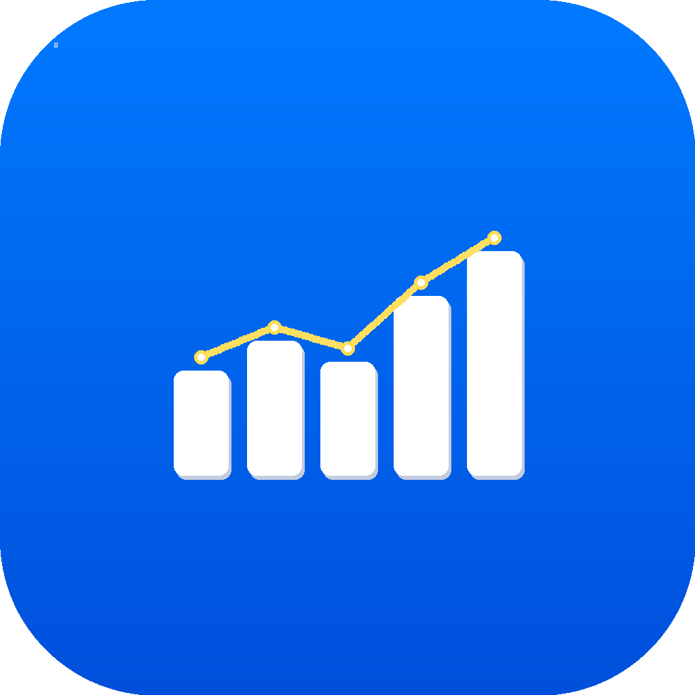

# Balance

A money app for your Mac. Track what you spend, what you earn, and what you own
— all of it stored on your own computer.

**Your figures stay on your Mac.** There is no account to make and no server to
sign in to. Currency conversion fetches public rates using only dates and
currency codes; your amounts and merchant names stay on your disk.

## Install

You need a Mac with Apple silicon (an M1, M2, M3 or M4 chip). To check, open the
Apple menu, then **About This Mac** — the Chip line should say Apple, not Intel.

**1.** Download `Balance-macOS-arm64.zip` from the
[latest release](../../releases/latest) and double-click to unzip.

**2.** Drag `Balance.app` into your Applications folder.

**3.** Open **Terminal** (press Cmd+Space, type Terminal, press Return), paste
this line and press Return:

```
xattr -cr /Applications/Balance.app
```

Nothing will print. That is normal. Now open Balance from your Applications
folder. You only need this once — the app is not signed with a paid Apple
developer certificate, so macOS blocks it until you clear the flag.

## Getting later versions

Quit Balance, then paste this into Terminal:

```
curl -fsSL https://raw.githubusercontent.com/JuliusPaulin/balance-app/main/update.sh | bash
```

It fetches the newest release, installs it and clears the macOS block. Your
figures are untouched — they live outside the app.

Newer versions check for updates in Balance and ask before installing one. If
you installed an older build without Sparkle, run the command above once to
install an updater-enabled version; later updates can happen in the app. You do
not need a Balance account or an Apple Developer account.

## What it does

- **Transactions** — add, edit, delete and filter expenses and income
- **CSV import** — Finnish bank statements, Nordea account and Platinum exports,
  Finnair credit card, and Revolut account statements
- **Currency conversion** — foreign CSV amounts convert to EUR at the transaction
  date's ECB reference rate. Weekends and holidays use the last published rate.
  Review shows the original amount, rate and rate date. Settings → Import currency
  sets the fallback for files with no currency column; each upload can override it.
- **Auto-categories** — merchant rules (exact, contains, fuzzy) sort rows for
  you, with a live preview while you write a rule and one-click re-apply to past
  transactions
- **Dashboard** — month by month spend against income, spending and income
  broken down by category, and annual reports. Click a month to see everything
  in it; the period picker follows you down the page
- **Spending heatmap** — a year calendar you can drill into by day
- **Net worth** — accounts, loans and investment holdings over time
- **Split costs** — halve every imported amount in one click, for shared spending
- **Month notes** — attach context to any month
- **Balance AI** — ask about your money in plain English, answered by a model
  running on your own Mac (see below)
- **Auto-backup** — a safe snapshot before every import and on quit

Revolut imports use **Started Date** and include only completed rows. Currency
exchanges are skipped; transfers and refunds remain in review. Fees on imported
rows reduce the signed amount before conversion. These are reference rates,
so the EUR value may differ from Revolut's own exchange price. Balance caches
past rates from [Frankfurter's ECB feed](https://frankfurter.dev/providers/ecb/)
and stops the import if it cannot get a valid rate. Confirmed amounts stay fixed.

## Balance AI

Ask it things — *what did I spend on groceries last month*, *did I spend more in
July than in June*, *analyse my latest month and tell me what stands out* — and
it answers from your own figures.

It runs on your Mac. Not a service, not an account, no API key: the app carries
its own model and never sends a word of your spending anywhere. It works with
the wi-fi off.

**The first time you open it, it downloads the model — about 2.7 GB, once.**
There is a button and a progress bar, the rest of the app keeps working while it
runs, and it picks up where it left off if it is interrupted. After that it
starts with the app. You need about 3 GB free.

Under every answer it tells you which screen it read and which months, because a
figure you cannot check is a figure you have to take on trust. It can only read:
it cannot add, edit or delete anything.

## Other assistants on this Mac

Balance AI, above, is the panel inside the app. A separate local MCP server lets
Claude Desktop, Cursor, or another assistant on this Mac read the same database
and import a CSV or change categories through Balance's own code, instead of
opening the SQLite file itself.

It speaks MCP over stdio only. It does not listen on a port, and it does not
send transactions anywhere. A non-EUR file is imported only when a rate is
already saved; otherwise import that file in the app. Writes are recorded and
can be undone. The design notes are in `docs/mcp-server-plan.md`.

From the repository, with the app's dependencies installed:

```
pip3 install -r requirements.txt
python3 -m balance_mcp
```

The database is the same file the app uses. Set `SQLITE_PATH` only to point at
a different one. The process has to be started from the repository so Python
can see `balance_mcp`.

Claude Desktop (`~/Library/Application Support/Claude/claude_desktop_config.json`)
and Cursor (`.cursor/mcp.json` in the project, or Cursor Settings → MCP) take
the same shape:

```json
{
  "mcpServers": {
    "balance": {
      "command": "python3",
      "args": ["-m", "balance_mcp"],
      "cwd": "/absolute/path/to/balance-app"
    }
  }
}
```

Use the full path to the `python3` that has the dependencies installed if it is
not the one on your `PATH`. Restart the assistant after saving the file.

| Tool | What it does |
|------|----------------|
| `list_accounts` | Net-worth accounts and latest balances. One id also returns that account's history. |
| `net_worth` | Assets, liabilities, net worth, and a monthly history. |
| `search_transactions` | Filter by dates, month, category, merchant, amount, and expense or income. |
| `spending_by_category` | Category totals for a month, a year, or a date range. |
| `cash_flow` | Income, expense, and net by month. Investments are also split out. |
| `list_categories` | Categories, with how often each is used. |
| `list_category_rules` | Merchant rules. |
| `preview_bank_import` | Read a CSV and report new rows, duplicates, and a sample. Writes nothing. |
| `commit_bank_import` | Import it. Pass `expected_new` from the preview. Duplicates are skipped unless asked. |
| `set_transaction_category` | Change one transaction's category. |
| `create_category` | Add a category. |
| `rename_category` | Rename a category. |
| `create_category_rule` | Add a merchant rule. Does not change past transactions. |
| `preview_recategorise` | Show what a rule would change. |
| `apply_recategorise` | Apply it. Pass `expected_updates` from the preview. |
| `suggest_categories` | Suggest a category for transactions currently in Other, from rules and history. |
| `apply_category_suggestions` | Apply those suggestions for the ids you pass. |
| `list_audit_log` | Recent writes. |
| `undo_change` | Reverse one of them. |

Spending rows are not attached to net-worth accounts. "Uncategorised" in this
file means the Other category, because every transaction has one.

## Your data

Everything is written to one SQLite file:

```
~/Library/Application Support/Balance/expenses.db
```

Rebuilding or reinstalling the app never touches it. To move Balance to another
Mac, copy that file across. To start again, delete it.

## Build it yourself

You need Python 3.11 and an Apple silicon Mac.

```
git clone https://github.com/JuliusPaulin/balance-app.git
cd balance-app
pip3 install -r requirements.txt
./scripts/build_app.sh
```

The app lands in `dist/Balance.app`. To install what you just built:

```
rm -rf /Applications/Balance.app && ditto dist/Balance.app /Applications/Balance.app
```

Run it from source instead, without packaging:

```
python3 main.py
```

Both read the same database, so your figures carry over either way.

The release build uses Sparkle's Ed25519 key. Keep a secure backup of the
private key and set it as the `SPARKLE_PRIVATE_KEY` GitHub Actions secret.
Never add the private key to the repository.

### Tests

```
python3 -m pytest tests/
```

They run against a throwaway database in a temp folder — your own figures are
never opened.

### Where things live

```
main.py, app.py             the launcher and the wiring
core.py, config.py          the Flask object and the settings
data/                       the database: db, engine, schema
services/                   net worth, recurring, imports, banking
ai/                         the assistant: tools, loop, backends, runtime
balance_mcp/                the local MCP server (stdio, not part of Balance.app)
routes/                     the API, one module per area
templates/, static/         the interface
tests/                      pytest suite
evals/                      the questions the assistant is judged on
scripts/                    build script and one-off tools
docs/                       plans/, research/, history/, mockups/
Balance.spec                the PyInstaller build recipe
update.sh                   the one-line updater
```

## Built with

Python, Flask and pywebview, packaged with PyInstaller.
